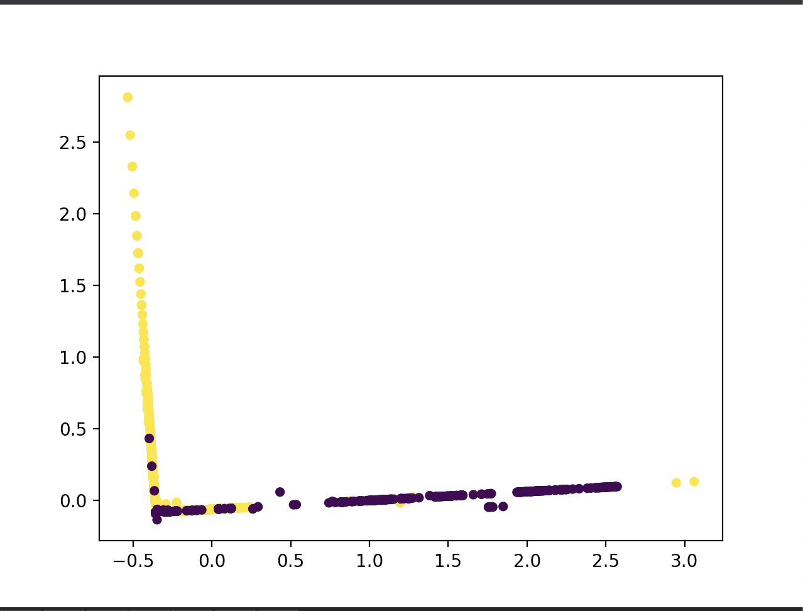
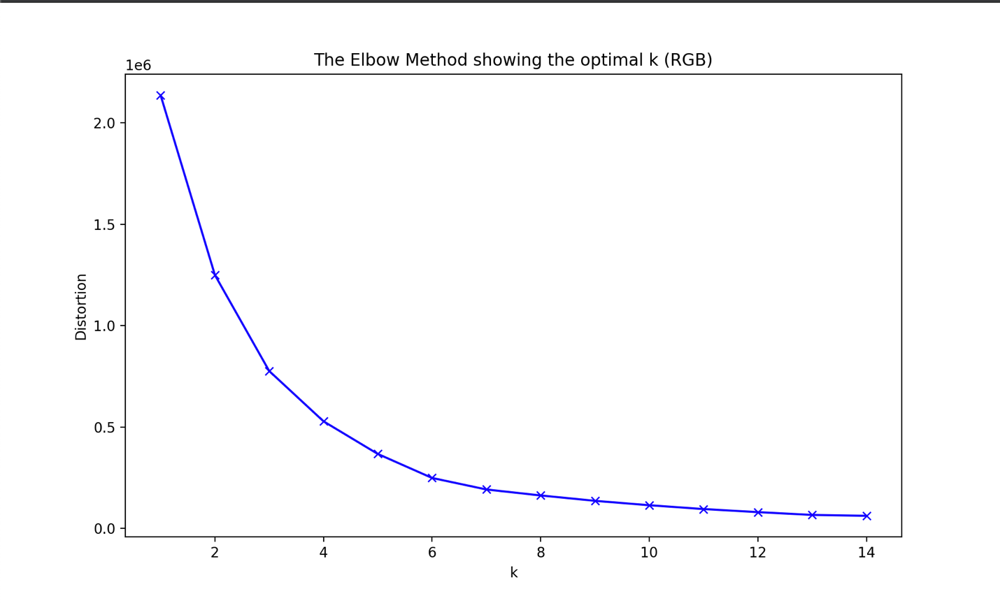

# Machine Learning & Data Analysis — Lab Practicum

Lab assignments for the *Machine Learning and Data Analysis* course (4th year, spring 2023).

The practicum covers the classic ML workflow end to end: image processing basics, preprocessing
of a large network-security dataset, a set of supervised classifiers for attack detection,
dimensionality reduction and unsupervised clustering.

## Tech stack

Python 3 · NumPy · pandas · SciPy · scikit-learn · Matplotlib · seaborn · Pillow

## Labs

| # | Topic | Methods |
|---|-------|---------|
| 01 | [Brightness-based image segmentation](lab01-image-segmentation) | Histogram analysis, local minima, threshold search |
| 03 | [Preprocessing of the BoT-IoT dataset](lab03-data-preprocessing) | Feature selection, standardization, z-score outliers, class balancing |
| 04 | [k-NN attack classifier](lab04-knn-classifier) | k-nearest neighbors, anomaly check, class probabilities |
| 05 | [Decision tree attack classifier](lab05-decision-tree) | Entropy-based decision tree, tree visualization |
| 06 | [Naive Bayes attack classifier](lab06-naive-bayes) | Gaussian Naive Bayes |
| 07 | [SVM attack classifier](lab07-svm) | Support vector machine (RBF kernel) |
| 08 | [PCA projection and cross-validation](lab08-pca-and-cross-validation) | PCA, K-fold cross-validation, model comparison |
| 09 | [Data visualization with PCA](lab09-pca-visualization) | PCA projection, loadings heatmap, feature informativeness |
| 10 | [k-means color clustering](lab10-kmeans-color-clustering) | k-means, elbow method, RGB / HSV / grayscale, HTML report |

Every lab folder has its own README with the task, the approach and the results.

## Highlights

**Attack detection on BoT-IoT** (labs 3–8): the same preprocessed dataset of network flows is used to compare
four classifiers. Accuracy on the hold-out set and mean K-fold cross-validation accuracy:

| Classifier | Accuracy | With PCA | Cross-validation |
|------------|----------|----------|------------------|
| Decision tree | **0.977** | 0.932 | **0.966** |
| k-NN (k = 3) | 0.956 | 0.939 (2 components) | 0.946 |
| SVM (RBF) | 0.813 | 0.812 | 0.682 |
| Gaussian Naive Bayes | 0.810 | 0.859 | 0.890 |

<p>
  
  
</p>

**Image and color processing** (labs 1 and 10): brightness-based segmentation and k-means color clustering.

<p>
  
  
</p>

## Repository structure

```
.
├── data/                            # datasets (not tracked, see below)
├── lab01-image-segmentation/
├── lab03-data-preprocessing/        # produces data/new_data.csv for labs 4–9
├── lab04-knn-classifier/
├── lab05-decision-tree/
├── lab06-naive-bayes/
├── lab07-svm/
├── lab08-pca-and-cross-validation/  # README only: experiments live in labs 4–7
├── lab09-pca-visualization/
├── lab10-kmeans-color-clustering/
└── requirements.txt
```

Each lab folder contains a single script, a README and an `images/` folder with result screenshots.
Generated artifacts (CSV, PDF, HTML) are written to the lab's `output/` folder.

## Getting started

```bash
python3 -m venv .venv
source .venv/bin/activate
pip install -r requirements.txt
```

Datasets are not stored in the repository. Put them into the [`data/`](data) folder before running the scripts:

| File | Used in | Source |
|------|---------|--------|
| `plane.jpg` | Lab 1 | Course materials |
| `dataframe.csv` | Lab 3 | 1M-row sample of [BoT-IoT](https://www.kaggle.com/datasets/vigneshvenkateswaran/bot-iot) |
| `new_data.csv` | Labs 4–9 | Generated by Lab 3 |
| `colors_2.csv` | Lab 10 | Course materials |

Run the scripts from the repository root; Lab 3 must be run before labs 4–9:

```bash
python3 lab03-data-preprocessing/preprocessing.py
python3 lab05-decision-tree/decision_tree.py
```

## Author

Ruslan Khasanshin, group 191-331
