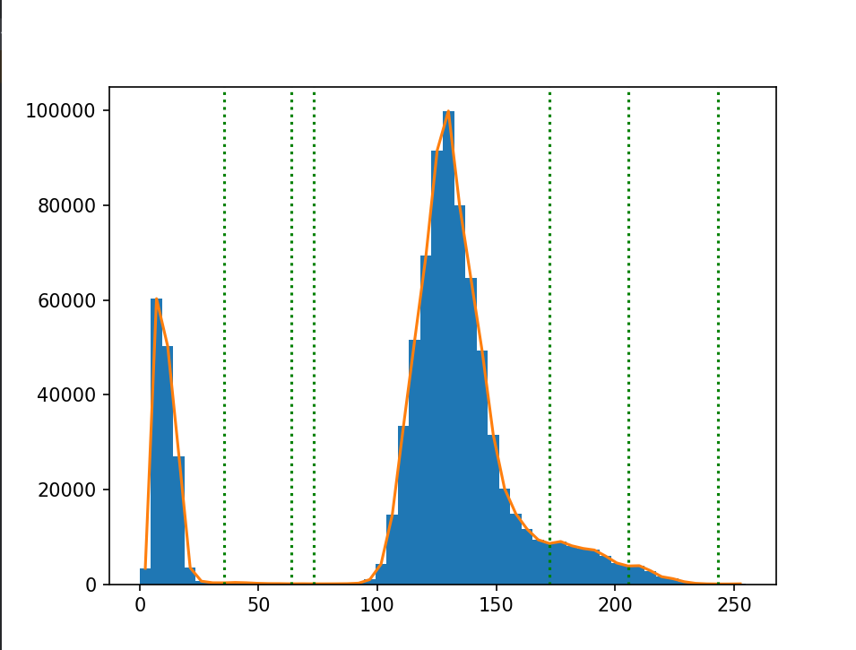
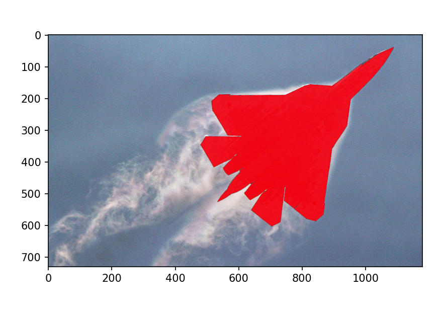
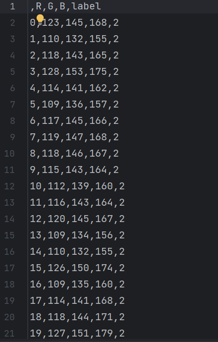

# Lab 1 — Brightness-based image segmentation

## Task

Segment the pixels of `plane.jpg` by brightness:

1. Build the brightness histogram and find the homogeneous regions separated by its local minima.
2. Pick a segmentation threshold and highlight the most frequent homogeneous region (the plane body).
3. Export every pixel as `R, G, B, label` where `label` is the brightness region of the pixel.

## Approach

- The image is converted to grayscale with the ITU-R BT.601 luma weights `0.299 R + 0.587 G + 0.114 B`.
- The histogram (54 bins) is normalized to a density, and `scipy.signal.argrelmin` finds its local minima.
- The threshold is chosen by an Otsu-style search that minimizes the total standard deviation of the two pixel groups.
- Pixels below the threshold are painted red; the rest of the image stays unchanged.
- Pixel labels are assigned by the 3rd and 5th local minima of the histogram.

## Results

Brightness histogram with local minima (dotted lines):



Segmented image — the plane body is highlighted in red:



Beginning of the exported `rgbl_result.csv` (~860k rows, one per pixel):



## Run

```bash
# data/plane.jpg is required
python3 lab01-image-segmentation/segmentation.py
```

The CSV is written to `lab01-image-segmentation/output/rgbl_result.csv`.
