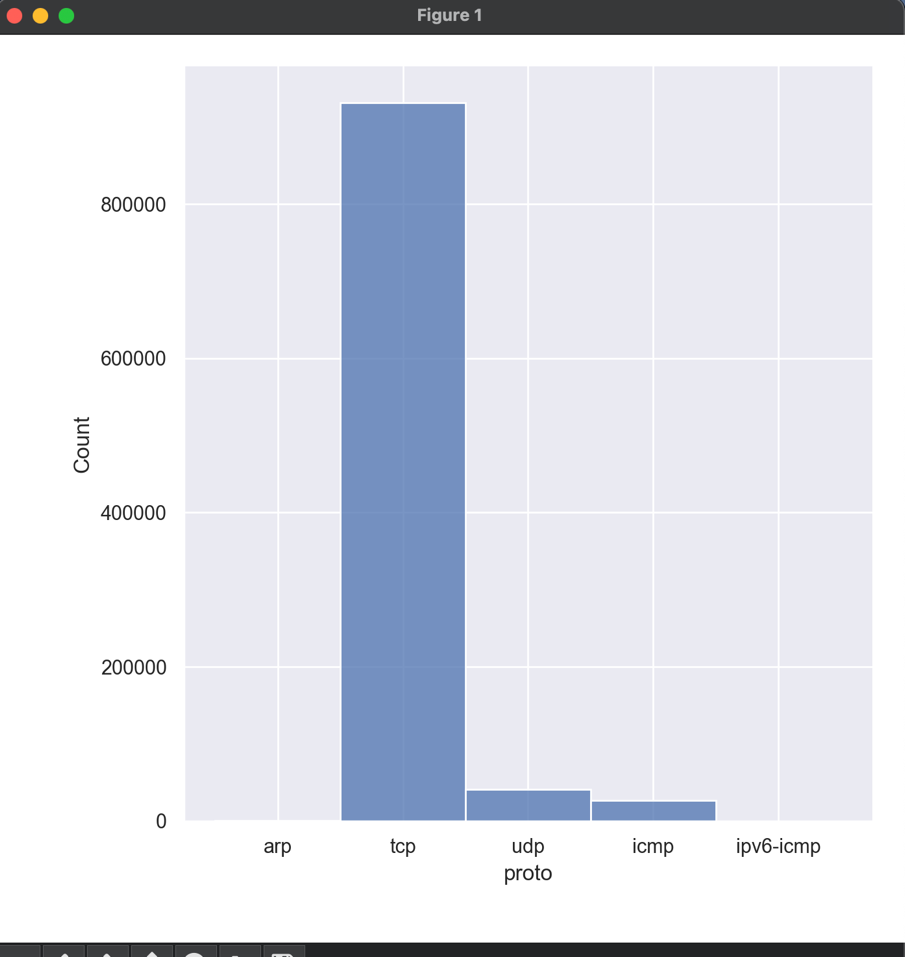

# Lab 3 — Preprocessing of a large information security dataset

## Task

Pick a labeled "big" dataset suitable for information security tasks and preprocess it:

1. Remove rows with missing values (keeping in mind that a gap can be a meaningful value).
2. Remove uninformative features.
3. Convert qualitative features to numeric ones.
4. Normalize / standardize numeric features.
5. Remove rows with outliers for every numeric feature.
6. Balance the classes.

The resulting dataset is reused by labs 4–9.

## Dataset

[BoT-IoT](https://www.kaggle.com/datasets/vigneshvenkateswaran/bot-iot) was created in the Cyber Range Lab of UNSW Canberra
and mixes normal traffic with botnet traffic: DDoS, DoS, OS and service scans, keylogging and data exfiltration.
The full capture is 69.3 GB of pcap (72M+ records); this lab uses a CSV sample of **1M network flows**.

Target: `attack` — `0` for normal traffic, `1` for an attack.

## Pipeline

| Step | What was done | Why |
|------|---------------|-----|
| Row cleanup | Removed `arp` and `icmp` flows and two rows with service names in port columns | ARP flows have no ports, ICMP flows store hex codes there; together they are ~2.6% of the data. 972,905 rows remain |
| Missing values | `smac`, `dmac`, `soui`, `doui`, `sco`, `dco` dropped | Empty in 100% of rows, so rows themselves could not be dropped |
| Uninformative features | `pkSeqID`, `stime`, `ltime`, `flgs`, `state`, `seq` dropped | Identifiers, timestamps and transaction state |
| Low-variance features | `category`, `subcategory` dropped | One value covers more than 90% of rows |
| Identifiers | `proto`, `saddr`, `daddr`, `sport`, `dport` dropped | Describe *who* talks, not *how*; useless for the model |
| Encoding | Not required | All remaining features are numeric |
| Scaling | `StandardScaler` on all features except the target | Features with a large scale must not dominate distance-based models |
| Outliers | Rows with `\|z\| > 3` in any feature removed | z-score rule |
| Balancing | Attacks downsampled to the number of normal flows | Classes are heavily imbalanced in BoT-IoT |

Final feature set (15): `pkts`, `bytes`, `dur`, `mean`, `stddev`, `sum`, `min`, `max`, `spkts`, `dpkts`, `sbytes`,
`dbytes`, `rate`, `srate`, `drate`. The balanced dataset contains about 2,800 rows.

## Results

Protocol distribution in the raw sample — TCP dominates, ARP and ICMP are a small fraction:



## Run

```bash
# data/dataframe.csv is required (BoT-IoT sample)
python3 lab03-data-preprocessing/preprocessing.py
```

The processed dataset is saved to `data/new_data.csv`.
