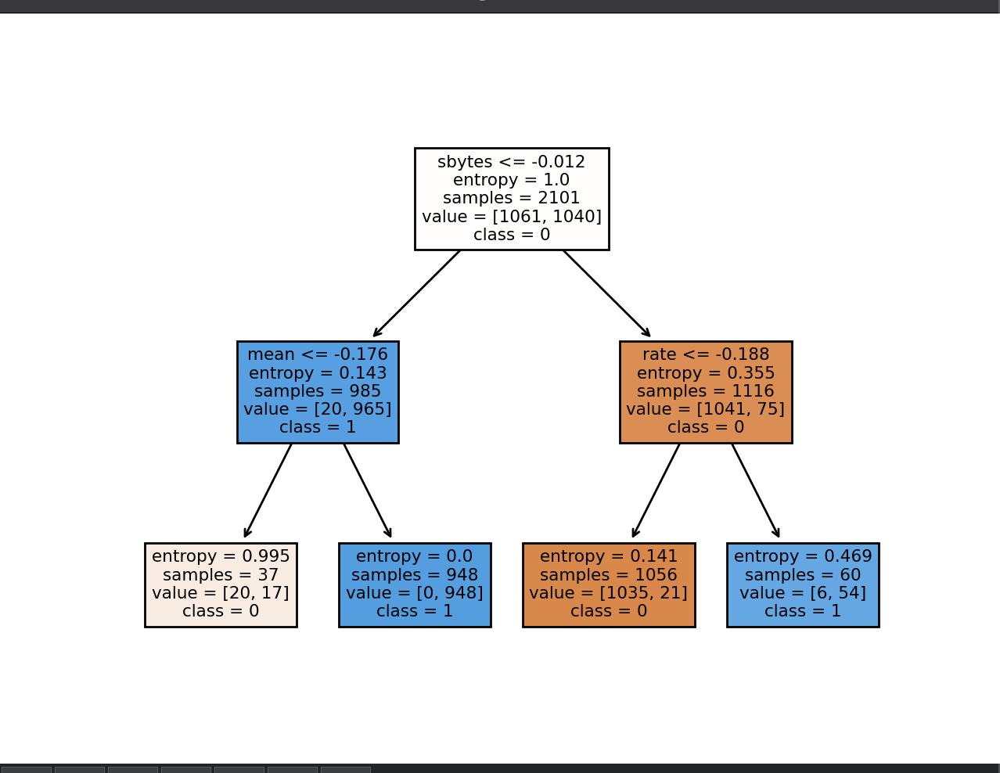

# Lab 5 — Decision tree classifier

## Task

Using the dataset from [lab 3](../lab03-data-preprocessing), build a classifier based on a decision tree:

1. Create, train and evaluate the classifier; visualize the tree.
2. Reject objects whose features fall outside the admissible ranges.
3. Demonstrate the classifier on a new object with decision probabilities.

## Approach

- 75/25 train/test split with a fixed `random_state`.
- `DecisionTreeClassifier(criterion="entropy", max_depth=2, min_samples_leaf=37)` — a deliberately shallow tree
  that stays readable and does not overfit.
- The tree is rendered with `sklearn.tree.plot_tree` and saved to `output/decision-tree.pdf`.
- The anomaly check is the same z-score rule as in [lab 4](../lab04-knn-classifier).

## Results

| Metric | Value |
|--------|-------|
| Test accuracy | **0.977** |
| Sample object | not anomalous |
| Prediction for the sample object | class `1` (attack), probabilities `[0.0, 1.0]` |

The trained tree: the first split by `sbytes` already separates most of the attacks,
the second level uses `mean` and `rate`.



The script also contains the PCA and cross-validation experiments for this model — see [lab 8](../lab08-pca-and-cross-validation) for the comparison.

## Run

```bash
# data/new_data.csv is required (output of lab 3)
python3 lab05-decision-tree/decision_tree.py
```
