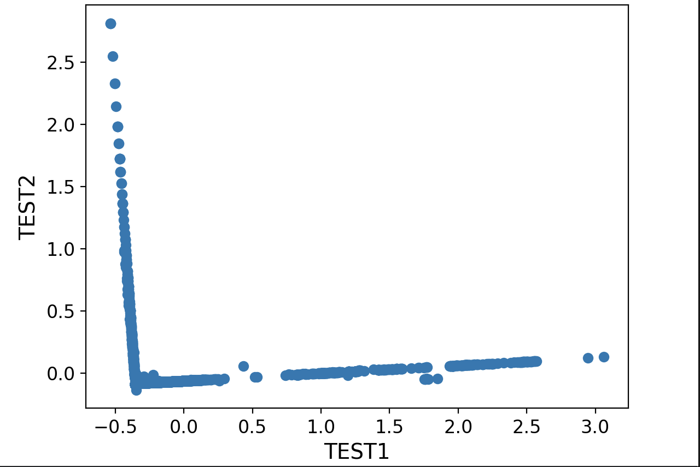
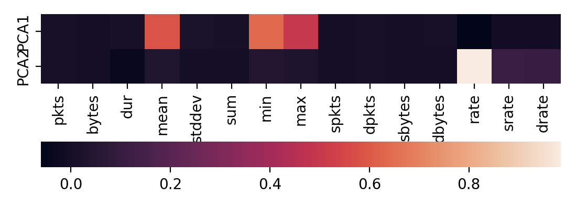

# Lab 9 — Data visualization with PCA

## Task

Using the dataset from [lab 3](../lab03-data-preprocessing):

1. Visualize the data in the space of the first two principal components.
2. Build a heatmap of the feature loadings of the first two principal components.
3. Use the loadings to find the least informative original features.

## Results

Projection onto the first two principal components:



The same projection colored by class (yellow — attacks, purple — normal traffic). The classes occupy two almost
orthogonal branches: attacks spread along PC2, normal flows along PC1. This is why k-NN keeps 94% accuracy
with only two components in [lab 8](../lab08-pca-and-cross-validation).


Feature loadings of the principal components:



- **PC1** is formed by the flow duration statistics `mean`, `min` and `max`.
- **PC2** is almost entirely the packet `rate`, with a small contribution of `srate` and `drate`.
- **Least informative features:** `pkts`, `bytes`, `dur`, `stddev`, `sum`, `spkts`, `dpkts`, `sbytes`, `dbytes` —
  their loadings are close to zero in both components.

## Run

```bash
# data/new_data.csv is required (output of lab 3)
python3 lab09-pca-visualization/pca_visualization.py
```
