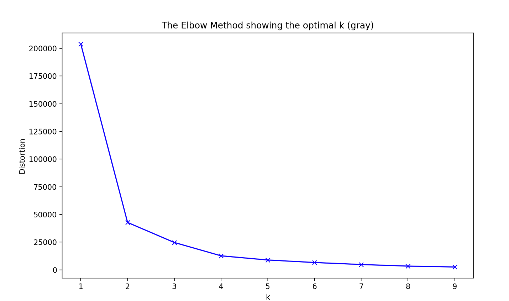
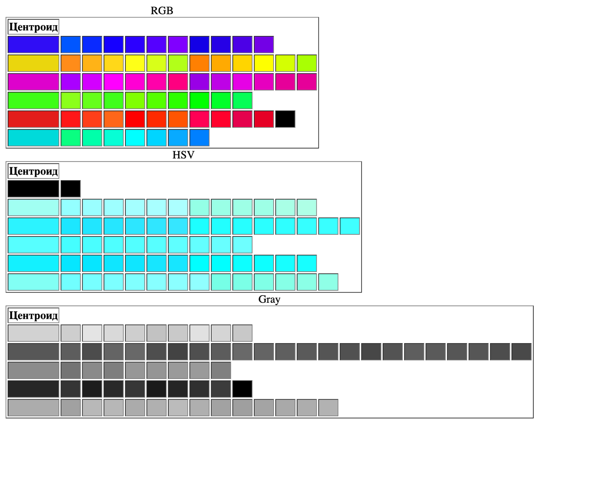

# Lab 10 — k-means color clustering

## Task

1. Split the colors from `colors_2.csv` into clusters with k-means; choose the number of clusters
   with the elbow method or the silhouette method.
2. Visualize the labeled dataset as an HTML file where every cluster and its centroid form a separate table row,
   and every cell is painted with the color of the corresponding object.
3. Repeat the task with colors expressed in (a) the HSV color model and (b) grayscale.

## Approach

- `colors_2.csv` stores colors as `x1:x2:x3` (R, G, B) rows.
- The elbow method: k-means inertia is plotted for k = 1…14 and k is picked where the curve stops dropping sharply.
- RGB → HSV conversion uses `colorsys.rgb_to_hsv` with OpenCV-style ranges (H in 0–179, S and V in 0–255).
- RGB → grayscale uses the same luma weights as in [lab 1](../lab01-image-segmentation): `0.299 R + 0.587 G + 0.114 B`.
- One HTML file contains three tables (RGB, HSV, Gray); the first cell of each row is the cluster centroid.

| Color space | Chosen k |
|-------------|----------|
| RGB | 6 |
| HSV | 4 |
| Grayscale | 4 |

## Results

Elbow plot for RGB — the curve flattens after k = 6:


Elbow plot for grayscale:



Example of the generated HTML report. RGB clusters group colors by hue (blue, yellow, magenta, green, red, cyan).
HSV cells are painted with the raw H, S, V values interpreted as RGB, so they show the cluster structure
rather than the real colors.



## Run

```bash
# data/colors_2.csv is required
python3 lab10-kmeans-color-clustering/color_clustering.py
```

The report is written to `lab10-kmeans-color-clustering/output/lab10_colors_2.html`.
